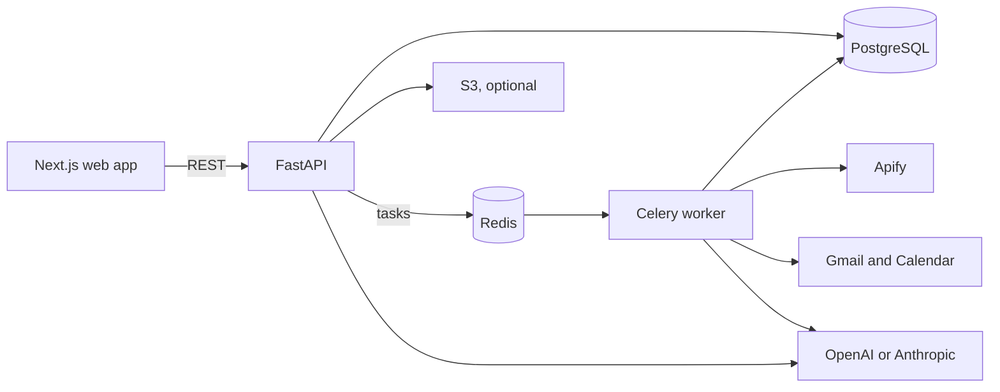

# jobsense

jobsense tracks a job search: listings, match scores, resumes, applications,
recruiting email and interview events. It is a monorepo with a FastAPI backend,
Celery workers and a Next.js web app.

It is a work in progress. The API covers most of the workflow; the web app is only
partly connected to it (see [Limitations](#limitations)).

## What the backend does

- Accounts with email and password or Google sign-in, using JWT access and refresh
  tokens.
- Pulls job listings through Apify actors, normalizes them and updates repeats
  from the same source.
- Scores a listing against a user profile: 70% language model judgement, 30%
  overlap between profile skills and the requirements.
- Stores resumes (text extracted from PDF or DOCX, optionally uploaded to S3),
  rewrites one for a listing with a language model, and exports a version as PDF.
- Tracks applications through a fixed set of statuses with an event history.
- Reads Gmail threads that look recruiting-related, classifies them and extracts
  interview details.
- Creates calendar events from those details and syncs upcoming Google Calendar
  events.
- Reports funnel, weekly, source and score statistics.

## How it works



Long-running work goes to Celery on five named queues: `ingestion`, `matching`,
`ai`, `email` and `calendar`.

Three LangGraph workflows are used: job matching, resume tailoring and email
classification with entity extraction. A fourth graph for job discovery exists in
the code but nothing calls it. Calendar events are created by an ordinary Celery
task.

The models default to `gpt-4o-mini` or `claude-3-5-haiku-20241022`, chosen by
`DEFAULT_LLM_PROVIDER`. The tailoring prompt tells the model not to invent
experience, and the only automatic check caps the output at twice the original
length, so read every tailored resume before using it.

The database has 17 tables, defined in one Alembic migration. It creates the
`vector` extension, but embeddings are not computed and no query uses vector
search.

## Requirements

- Docker with Compose
- Python 3.11 and [Poetry](https://python-poetry.org/)
- Node.js 20 and pnpm 9

## Setup

```bash
git clone https://github.com/sushildalavi/jobsense.git
cd jobsense
make setup-dev
```

This installs both dependency sets, copies the environment examples, starts
PostgreSQL and Redis in Docker, runs the migration and loads demo data.

Then, in separate terminals:

```bash
make dev-api      # API on http://localhost:8000
make dev-web      # web app on http://localhost:3000
make dev-worker   # Celery worker
```

The web app imports types from `packages/types`. Build them once with
`pnpm --filter @jobsense/types build`.

The seed script creates the user `demo@jobsense.dev` with password `DemoPass123`.
Use it only on a local database.

### Backend in Docker

```bash
cp .env.example .env
docker compose up --build
docker compose exec api alembic upgrade head
```

This starts PostgreSQL, Redis, the API, a worker, Celery beat and Flower
(<http://localhost:5555>). All ports are bound to `127.0.0.1`. The web app is not
part of the Compose stack. No periodic tasks are scheduled, so beat is idle.

## Configuration

| File | Read by |
|---|---|
| `.env` | Docker Compose |
| `apps/api/.env` | API and worker run from `apps/api` |
| `apps/web/.env.local` | Web app |

| Variable | Purpose |
|---|---|
| `DATABASE_URL` | PostgreSQL URL (`postgresql://...`); the async driver is added automatically |
| `REDIS_URL` | Celery broker and results |
| `SECRET_KEY` | Token signing key. Outside `development` and `test` it must be a private value of 32 or more characters |
| `ENVIRONMENT` | `development` (default), `test`, `staging` or `production` |
| `FRONTEND_URL` | Web origin allowed by CORS |
| `OPENAI_API_KEY`, `ANTHROPIC_API_KEY`, `DEFAULT_LLM_PROVIDER` | Language model features |
| `APIFY_API_TOKEN` | Job ingestion |
| `GOOGLE_CLIENT_ID`, `GOOGLE_CLIENT_SECRET`, `GOOGLE_REDIRECT_URI` | Google sign-in |
| `AWS_ACCESS_KEY_ID`, `AWS_SECRET_ACCESS_KEY`, `AWS_REGION`, `S3_BUCKET_NAME` | Resume file storage |
| `NEXT_PUBLIC_API_URL` | API origin used by the web app, without `/api/v1` |

## API

Routes are under `/api/v1`; interactive documentation is at `/docs`.

| Area | Routes |
|---|---|
| Auth | `POST /auth/register`, `/auth/login`, `/auth/refresh`, `/auth/logout`, `/auth/forgot-password`, `/auth/reset-password`; `GET /auth/me`, `/auth/google`, `/auth/google/callback` |
| User | `GET`, `PATCH`, `DELETE /users/me`; `GET /users/me/integrations`; `GET`, `PUT`, `PATCH /profile` |
| Jobs | `GET /jobs`, `/jobs/sources`, `/jobs/search` (keyword), `/jobs/{id}`; `POST /jobs/sync`, `/jobs/{id}/match`; `POST`, `DELETE /jobs/{id}/shortlist` |
| Resumes | `GET`, `POST /resumes`; `GET`, `PATCH`, `DELETE /resumes/{id}`; `POST /resumes/{id}/parse`; `GET /resumes/{id}/versions`, `/resumes/versions/{id}`; `POST /resumes/versions/{id}/export-pdf` |
| Applications | `GET`, `POST /applications`; `GET`, `PATCH`, `DELETE /applications/{id}`; `PATCH /applications/{id}/status`; `POST /applications/{id}/transition`, `/applications/{id}/tailor-resume`; `GET /applications/{id}/events`, `/emails`, `/calendar`, `/resume` |
| Email | `GET /emails/threads`, `/emails/threads/{id}`, `/emails/parsed`; `POST /emails/sync`, `/emails/classify` |
| Calendar | `GET`, `POST /calendar/events`; `PATCH`, `DELETE /calendar/events/{id}`; `POST /calendar/sync` |
| Analytics | `GET /analytics/dashboard`, `/funnel`, `/weekly`, `/sources`, `/match-scores`, `/agent-runs` |
| Workflows | `POST /agents/run`; `GET /agents/runs`, `/agents/runs/{id}` |

## Project layout

```
apps/api/            FastAPI app, Alembic migration, seed script, tests
  app/api/v1/        Routers and dependencies
  app/services/      Business logic
  app/tasks/         Celery tasks
  app/agents/        LangGraph workflows and prompts
  app/integrations/  Apify, Gmail and Google Calendar clients
apps/web/            Next.js 15 app (src/app, src/components, src/api, src/hooks)
packages/types/      TypeScript types for the web app
packages/shared/     Utilities, currently unused by the web app
packages/config/     Shared TypeScript settings
docker/postgres/     Database initialization
```

## Tests and checks

The API tests need PostgreSQL (with pgvector) and Redis, and a migrated database
named by `DATABASE_URL`; use a database you can discard.

```bash
cd apps/api
poetry run alembic upgrade head
ENVIRONMENT=test poetry run pytest
poetry run ruff check . --select E,F,I
poetry run ruff format --check .

pnpm --filter @jobsense/types build
pnpm --filter @jobsense/shared build
pnpm --filter @jobsense/web check
pnpm --filter @jobsense/web lint
pnpm --filter @jobsense/web build
```

The web app has no tests. Nothing tests the live Apify, Google, S3 or model
provider integrations.

## Deployment

Configuration for Railway and Vercel is described in [DEPLOY.md](DEPLOY.md). Read
it before adding credentials: every push to `main` starts deployment workflows.

## Limitations

- The web app was written against a different API shape. Analytics summary,
  resume tailoring and activation, and single calendar events call routes that do
  not exist; some job filters, dashboard numbers, match score scales and profile
  fields do not line up; and settings for provider keys are ignored by the API.
- The web app links to forgot-password, terms and privacy pages that do not exist.
- Password reset sends no email. In development the link is written to the log.
- Logout does not revoke tokens. Access tokens last seven days by default.
- Google OAuth does not validate `state`, stores tokens unencrypted, saves them
  only when the account already exists, and gives the Gmail and Calendar clients
  no client credentials for refreshing them.
- Email classification and extraction see only the thread subject, not the body.
- Workflow runs are recorded only when started through `/agents/run`, without
  token counts.
- Job ingestion has not been verified against Apify. No route creates job
  sources, only sources of type `apify` are synced (the demo data has none), and
  the client's actor ID and input format should be checked against Apify's API.
- Duplicate detection across sources is not implemented.
- There is no rate limiting.

## License

This repository does not include a license file.
